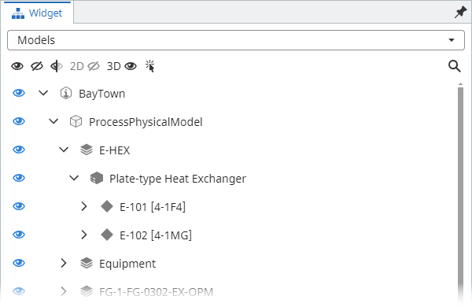
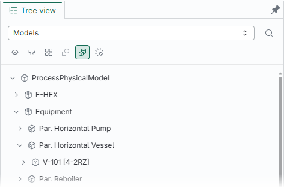
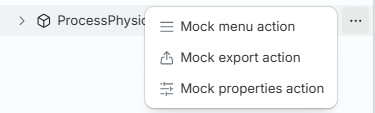
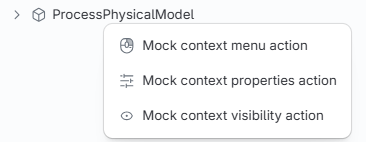
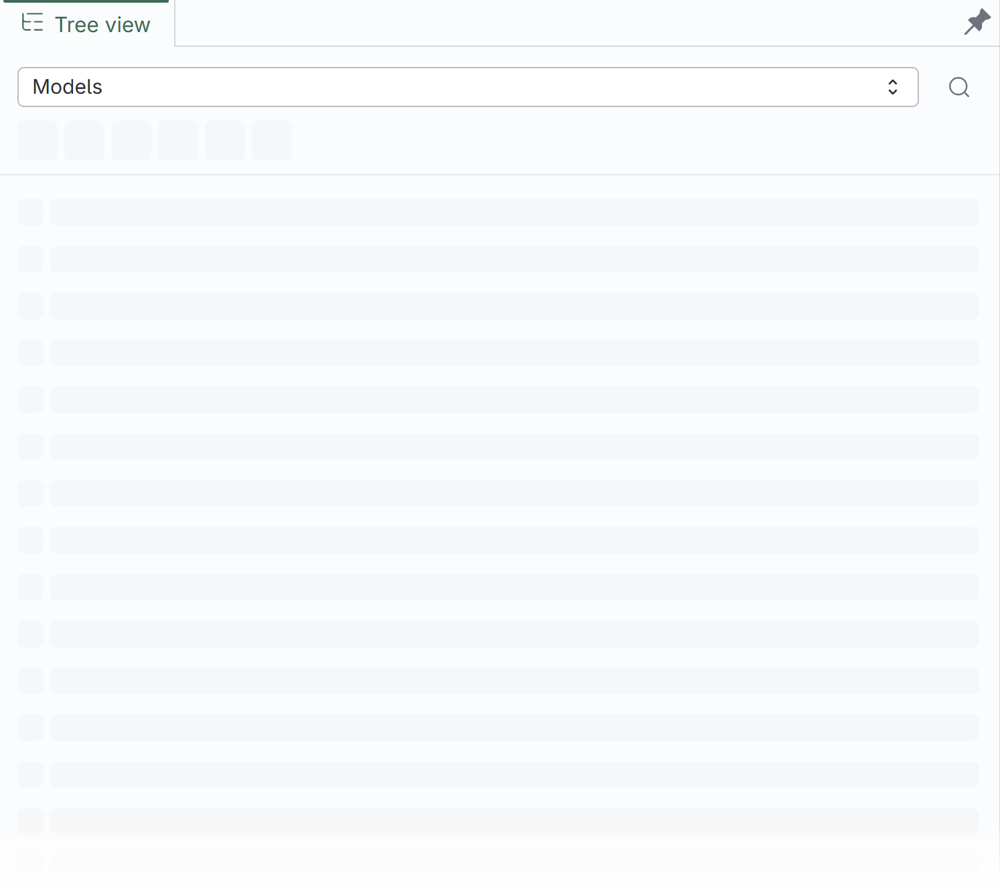
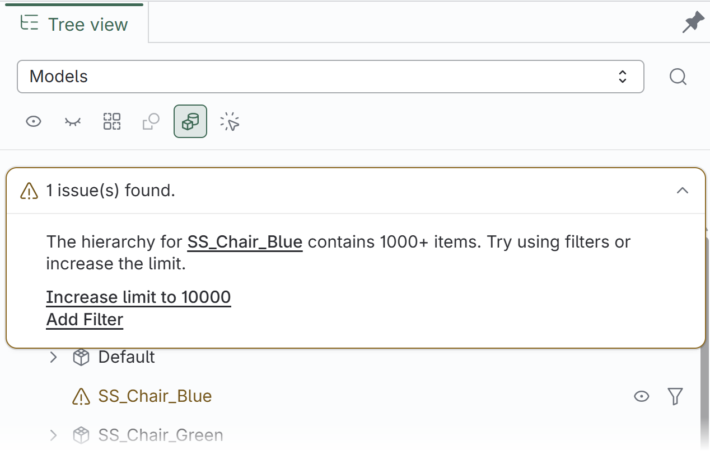
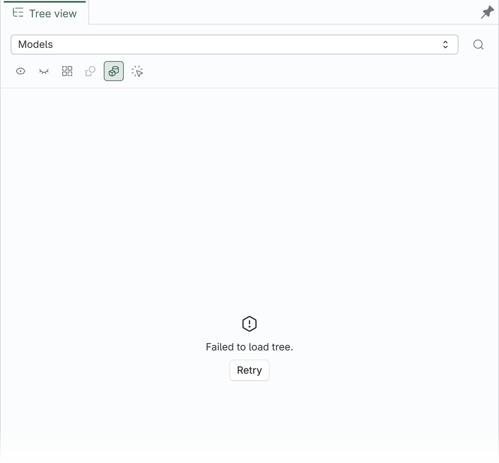
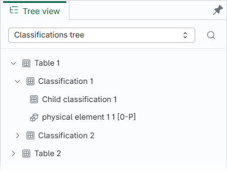

# Change Log - @itwin/tree-widget-react

## 4.0.0

### Major Changes

- [#1795](https://github.com/iTwin/viewer-components-react/pull/1795): Tree Widget v4 is here. This release introduces a new design system, powerful ways to explore and customize iModel content, more reliable visibility controls, and broad performance and stability improvements. Here is why you should upgrade.

  ## Why upgrade?

  ### 1. A modern, accessible design system

  Tree Widget has been rebuilt with [MUI](https://mui.com/material-ui/getting-started/) and [StrataKit](https://stratakit.bentley.com/), bringing it in line with the latest iTwin application design system. The new foundation provides a cleaner visual language, accessible labels, consistent keyboard and focus behavior, and semantic controls supplied by MUI and StrataKit.

  | v3 - iTwinUI                                                                            | v4 - MUI and StrataKit                                                                 |
  | --------------------------------------------------------------------------------------- | -------------------------------------------------------------------------------------- |
  |  |  |

  ### 2. New features

  Tree Widget v4 introduces several new features for both end users and applications building custom tree workflows:

  - **Flexible node actions** can display frequently used actions inline, place additional commands in an overflow menu, and provide contextual actions when a user opens a node's context menu.

    <table>
      <thead>
        <tr>
          <th>Inline actions</th>
          <th>Overflow menu</th>
          <th>Context menu</th>
        </tr>
      </thead>
      <tbody>
        <tr>
          <td valign="top"></td>
          <td valign="top"></td>
          <td valign="top"></td>
        </tr>
      </tbody>
    </table>

  - **Clearer loading, warning, and error states** with skeleton placeholders, actionable hierarchy warnings, and a Retry action when loading fails.

    <table>
      <thead>
        <tr>
          <th>Loading placeholders</th>
          <th>Actionable hierarchy warnings</th>
          <th>Error and retry</th>
        </tr>
      </thead>
      <tbody>
        <tr>
          <td valign="top"></td>
          <td valign="top"></td>
          <td valign="top"></td>
        </tr>
      </tbody>
    </table>

  - **A new Classifications tree** for applications that work with classification systems, including selection, visibility controls, node actions, label editing, and search.

    

  - **Easier integration with different viewports.** Tree Widget is now less tightly coupled to the iTwin.js viewport, making it much easier to integrate with different viewport implementations (e.g., Unity).
  - **More configurable Models and Categories hierarchies.** New options provide greater control over the contents of each tree. For example, the Categories tree can now include element nodes.
  - **New customization building blocks** including exported node type guards, renderer props, actions, and icons.

  ### 3. Reliable and consistent visibility controls

  Visibility controls now behave consistently across complete, nested, and filtered hierarchies:

  - Changing an ancestor's visibility updates all of its nested children.
  - Changes to children are reflected in the visibility states of all ancestor nodes.
  - When a search results hierarchy is displayed, visibility changes affect only the nodes represented in those results.
  - Visibility states update optimistically for immediate feedback.
  - Rapid or superseded operations no longer leave visibility controls out of sync.

  ### 4. Performance improvements

  Version 4 includes extensive performance work across hierarchy queries, search, visibility calculations, and rendering. These improvements reduce repeated work when loading and expanding large trees, searching Models and Categories trees, and updating visibility throughout nested content.

  ### 5. Bug fixes and improved resilience

  In addition to the larger improvements above, v4 resolves issues that could affect everyday use of v3. Some highlights include:

  - Label search now consistently finds matching nodes throughout nested hierarchies, including categories beneath sub-models that could be missed in v3.
  - Loading failures display a clear error message and Retry action.
  - Interrupted visibility queries no longer crash the application.

  These are only a few of the bug fixes and stability improvements included in v4.

  ## Breaking changes and migrating from v3

  Migrating to v4 should be straightforward for most applications. In the vast majority of cases, only sections 1–3 of the [migration guide](./docs/Migration_v3_v4.md) are needed. Applications with more extensive customization or direct use of lower-level components may also require changes from sections 4–8. The guide is comprehensive: it covers every breaking change and provides instructions and examples for migrating each one.

  #### Application setup

  - **Rendering and theming moved to MUI and StrataKit.** Tree Widget no longer renders with `@itwin/itwinui-react`; rendering now depends on compatible MUI and StrataKit themes and peer dependencies. ([migration](./docs/Migration_v3_v4.md#1-update-dependencies), PRs: [#1169](https://github.com/iTwin/viewer-components-react/pull/1169), [#1320](https://github.com/iTwin/viewer-components-react/pull/1320), [#1748](https://github.com/iTwin/viewer-components-react/pull/1748))
  - **Runtime and package requirements changed.** v4 requires React 18 or 19, the peer dependency versions declared by the package—including iTwin.js 5.14, AppUI 5.35, `@itwin/presentation-components` 6, MUI, and StrataKit—and an ESM-compatible application and test setup. `@stratakit/foundations` is a new peer dependency that the application must install and configure. The package no longer publishes a CommonJS build. ([migration](./docs/Migration_v3_v4.md#1-update-dependencies), PRs: [#1642](https://github.com/iTwin/viewer-components-react/pull/1642), [#1748](https://github.com/iTwin/viewer-components-react/pull/1748), [#1811](https://github.com/iTwin/viewer-components-react/pull/1811), [#1813](https://github.com/iTwin/viewer-components-react/pull/1813), [#1835](https://github.com/iTwin/viewer-components-react/pull/1835), [#1843](https://github.com/iTwin/viewer-components-react/pull/1843))
  - **Global initialization was replaced by `TreeWidgetContextProvider`.** The `TreeWidget` class and its initialization, termination, and localization helpers were removed. `TreeWidgetContextProvider`, `createTreeWidget`, and `TreeWidgetComponent` now receive localization and optional logging services, and the widget APIs add the provider automatically. ([migration](./docs/Migration_v3_v4.md#2-replace-global-initialization-with-treewidgetcontextprovider), PRs: [#1303](https://github.com/iTwin/viewer-components-react/pull/1303), [#1617](https://github.com/iTwin/viewer-components-react/pull/1617), [#1783](https://github.com/iTwin/viewer-components-react/pull/1783))
  - **Header-button telemetry is provided through context.** `onFeatureUsed` was removed from standard header-button props, and custom-tree telemetry is now supplied through `TelemetryContextProvider`. ([migration](./docs/Migration_v3_v4.md#telemetry), PRs: [#1783](https://github.com/iTwin/viewer-components-react/pull/1783))
  - **Tree components and renderers now require `treeLabel`.** The label is required by standard tree components, `TreeRenderer`, and `VisibilityTreeRenderer`, and widget tree definitions receive it through their render callback. ([migration](./docs/Migration_v3_v4.md#3-update-widget-registration-and-standard-tree-components), PRs: [#1495](https://github.com/iTwin/viewer-components-react/pull/1495))
  - **The `density` and `getSchemaContext` props were removed.** `density` is no longer accepted by tree components, header-button renderer props, or `TreeDefinition.render` props, and the schema context is now created internally. ([migration](./docs/Migration_v3_v4.md#3-update-widget-registration-and-standard-tree-components), PRs: [#1186](https://github.com/iTwin/viewer-components-react/pull/1186), [#1331](https://github.com/iTwin/viewer-components-react/pull/1331))

  #### Widget and tree composition

  - **The widget and header components changed roles, and the `SelectableTree` name was reused.** The v3 tree selector `SelectableTree` is now `TreeWidgetComponent`, and the v3 header container `TreeWithHeader` is now `SelectableTree`. `SelectableTreeDefinition` was replaced by `TreeDefinition`, whose `getLabel` receives `{ standardLabels }` and whose `render` receives `treeLabel` and, for searchable definitions, `searchText`. ([migration](./docs/Migration_v3_v4.md#replace-the-widget-and-header-components), PRs: [#1186](https://github.com/iTwin/viewer-components-react/pull/1186))
  - **Standard tree components no longer render their own search input.** `TreeWithHeader.filteringProps` was removed, widget-header search is now controlled by `TreeDefinition.isSearchable`, and directly rendered standard trees accept search text through `searchText`. ([migration](./docs/Migration_v3_v4.md#preserve-search-ui), PRs: [#1186](https://github.com/iTwin/viewer-components-react/pull/1186), [#1289](https://github.com/iTwin/viewer-components-react/pull/1289))
  - **Standard tree hooks return different values.** `useModelsTree` and `useCategoriesTree` return `treeProps` and `getTreeItemProps` instead of `modelsTreeProps` or `categoriesTreeProps` together with `rendererProps`. ([migration](./docs/Migration_v3_v4.md#update-standard-tree-hook-results), PRs: [#1540](https://github.com/iTwin/viewer-components-react/pull/1540))
  - **Categories tree header buttons require `models`.** `CategoriesTreeHeaderButtonProps` gained a required `models` property, and `onCategoriesFiltered` now receives `{ categories, models }` instead of a categories array. `useCategoriesTreeButtonProps` supplies both. ([migration](./docs/Migration_v3_v4.md#update-categories-tree-buttons), PRs: [#1265](https://github.com/iTwin/viewer-components-react/pull/1265))

  #### Tree renderer and action APIs

  - **Node customization moved to `getTreeItemProps`.** The single callback supersedes the v3 `getLabel`, `getIcon`, and `getSublabel` renderer props through its `label`, `decorations`, and `description` results. Its `onClick`, `onKeyDown`, and `onDoubleClick` handlers supersede the corresponding v3 node handlers. Callback nodes now use `TreeNode` from `@itwin/presentation-hierarchies-react` v2, and click handlers no longer receive the v3 `isSelected` argument. The `filterButtonsVisibility`, `size`, and `enableVirtualization` renderer props were removed without replacement. ([migration](./docs/Migration_v3_v4.md#migrate-renderer-props), PRs: [#1540](https://github.com/iTwin/viewer-components-react/pull/1540), [#1557](https://github.com/iTwin/viewer-components-react/pull/1557))
  - **Tree actions were redesigned and expanded.** The v3 `getActions` callback was replaced by `getInlineActions`, `getMenuActions`, and `getContextMenuActions`. These callbacks receive `{ targetNode, selectedNodes }` and return React elements: up to two `TreeActionBase` elements inline, and `TreeActionBase` or divider elements in the menus. Standard tree components additionally supply the current renderer props as a second argument; callbacks passed directly to `TreeRenderer` or `VisibilityTreeRenderer` receive only the action context. ([migration](./docs/Migration_v3_v4.md#migrate-node-actions), PRs: [#1394](https://github.com/iTwin/viewer-components-react/pull/1394), [#1485](https://github.com/iTwin/viewer-components-react/pull/1485), [#1522](https://github.com/iTwin/viewer-components-react/pull/1522), [#1534](https://github.com/iTwin/viewer-components-react/pull/1534))
  - **The hierarchy level filter callback was renamed.** The `onFilterClick` renderer prop is now `filterHierarchyLevel`. ([migration](./docs/Migration_v3_v4.md#onfilterclick-to-filterhierarchylevel), PRs: [#1557](https://github.com/iTwin/viewer-components-react/pull/1557))
  - **Visibility renderer callbacks were renamed.** `getCheckboxState` and `onCheckboxClicked` became `getVisibilityButtonState` and `onVisibilityButtonClick`, the `"on"` and `"off"` states became `"visible"` and `"hidden"`, and the click callback now receives the node's current state instead of the state to apply. ([migration](./docs/Migration_v3_v4.md#migrate-custom-visibility-renderers), PRs: [#1320](https://github.com/iTwin/viewer-components-react/pull/1320))

  #### Search APIs

  - **Filtering APIs were renamed to search APIs.** `filter` became `searchText`, `getFilteredPaths` became `getSearchPaths`, and `FilterLimitExceededError` became `SearchLimitExceededError`. Localized keys under `*tree.filtering` moved to `*tree.search`, including `tooManySearchMatches` and `unknownSearchError`. ([migration](./docs/Migration_v3_v4.md#4-rename-search-and-renderer-apis), PRs: [#1539](https://github.com/iTwin/viewer-components-react/pull/1539))
  - **Hierarchy search and EC class-name types changed.** `getSearchPaths` and `getSubTreePaths` now return `HierarchySearchTree[]` instead of the v3 `HierarchyFilteringPath[]` representation, and the path option `autoExpand` became `reveal`. Configuration APIs that accept full EC class names now use `EC.FullClassNameDotNotation` and require dot notation such as `BisCore.GeometricElement3d`; colon notation is no longer accepted. ([migration](./docs/Migration_v3_v4.md#hierarchyfilteringpath-to-hierarchysearchtree), PRs: [#1636](https://github.com/iTwin/viewer-components-react/pull/1636))
  - **Tree highlighting now uses a text value.** The `highlight` object prop on `Tree` and `VisibilityTree` was replaced by the `highlightText` string prop. The tree props returned by the standard-tree hooks use the same name. ([migration](./docs/Migration_v3_v4.md#highlight-to-highlighttext), PRs: [#1408](https://github.com/iTwin/viewer-components-react/pull/1408))
  - **Custom empty-tree content uses `emptyTreeContent`.** The v3 `noDataMessage` prop on `Tree`, `VisibilityTree`, standard tree components, and standard-tree hook results was renamed to `emptyTreeContent`. ([migration](./docs/Migration_v3_v4.md#nodatamessage-to-emptytreecontent), PRs: [#1214](https://github.com/iTwin/viewer-components-react/pull/1214))

  #### Visibility APIs

  - **Tree visibility APIs now use `TreeWidgetViewport`.** Models, Categories, and Classifications tree components accept an optional `TreeWidgetViewport` and otherwise use AppUI's active viewport. Hooks and header-button APIs that previously accepted an iTwin.js `Viewport` now use the narrower abstraction, and `createTreeWidgetViewport` adapts an iTwin.js viewport. ([migration](./docs/Migration_v3_v4.md#convert-viewport-values-used-by-hooks-and-header-buttons), PRs: [#1466](https://github.com/iTwin/viewer-components-react/pull/1466))
  - **Custom hierarchy visibility handlers use standard disposal.** `HierarchyVisibilityHandler` now extends `Disposable`, and its disposal API changed from `dispose()` to `[Symbol.dispose]()`. ([migration](./docs/Migration_v3_v4.md#7-update-custom-visibility-apis), PRs: [#1320](https://github.com/iTwin/viewer-components-react/pull/1320))
  - **Models tree visibility override callbacks changed.** `ModelsTreeVisibilityHandlerOverrides` callbacks now use `get*VisibilityStatus` and `change*VisibilityStatus` names, accept entity-specific `Id64Arg` parameters, and allow `modelId` to be omitted from category callbacks. ([migration](./docs/Migration_v3_v4.md#7-update-custom-visibility-apis), PRs: [#1401](https://github.com/iTwin/viewer-components-react/pull/1401), [#1403](https://github.com/iTwin/viewer-components-react/pull/1403))
  - **Custom visibility status APIs changed.** `VisibilityStatus.tooltip` was removed from custom hierarchy visibility handlers. Renderer-specific visibility button state may still supply a tooltip. ([migration](./docs/Migration_v3_v4.md#7-update-custom-visibility-apis), PRs: [#1286](https://github.com/iTwin/viewer-components-react/pull/1286))

  #### Hierarchy

  - **Models and Categories hierarchy configuration is now organized by node type.** Settings for categories, subjects, models, and elements use a new nested structure, and the `enableWithCounts` grouping value is now `enable-with-counts`. Omitted settings continue to preserve the v3 defaults. ([migration](./docs/Migration_v3_v4.md#5-update-hierarchy-configuration), PRs: [#1738](https://github.com/iTwin/viewer-components-react/pull/1738))
  - **Models and Categories trees now display intermediate category nodes.** When a child element uses a different category than its parent, it is grouped beneath an intermediate node for its own category instead of appearing directly beneath the parent element. This adds another level to affected hierarchy paths. ([migration](./docs/Migration_v3_v4.md#8-account-for-tree-content-changes), PRs: [#1716](https://github.com/iTwin/viewer-components-react/pull/1716))

### Minor Changes

- [#1795](https://github.com/iTwin/viewer-components-react/pull/1795): #### Search and loading

  - **Built-in widget-header search.** Search can be enabled per tree with `TreeDefinition.isSearchable`, and the debounced value is delivered through `searchText`. The UI includes no-results, too-many-results, and instance-focus warning states. (PRs: [#1186](https://github.com/iTwin/viewer-components-react/pull/1186), [#1235](https://github.com/iTwin/viewer-components-react/pull/1235), [#1240](https://github.com/iTwin/viewer-components-react/pull/1240), [#1289](https://github.com/iTwin/viewer-components-react/pull/1289))
  - **Loading placeholders for built-in and custom trees.** Trees show skeletons during initial loading and search, the widget header has a loading state, and the exported `SkeletonTree` lets custom trees use the same placeholder. (PRs: [#1252](https://github.com/iTwin/viewer-components-react/pull/1252), [#1299](https://github.com/iTwin/viewer-components-react/pull/1299), [#1504](https://github.com/iTwin/viewer-components-react/pull/1504))
  - **Categories trees can search for elements by ID.** (PRs: [#1710](https://github.com/iTwin/viewer-components-react/pull/1710))
  - **Search result limits are configurable.** `useCategoriesTree`, `useModelsTree`, and `useClassificationsTree` accept `searchLimit` as a number or `"unbounded"`. Searches supplied to `useClassificationsTreeDefinition` support the same values through `search.limit`. (PRs: [#1636](https://github.com/iTwin/viewer-components-react/pull/1636))

  #### Customization

  - **Standard tree nodes can be identified through exported helpers.** The `ModelsTreeNode`, `CategoriesTreeNode`, and `ClassificationsTreeNode` namespaces provide type guards for individual node types and a `getType` helper for identifying any supported type from node metadata. (PRs: [#1548](https://github.com/iTwin/viewer-components-react/pull/1548), [#1742](https://github.com/iTwin/viewer-components-react/pull/1742))
  - **Tree renderers expose the underlying StrataKit tree props.** Applications can pass supported props through exported renderers to customize the underlying `Tree.Root` and `Tree.Item` elements. (PRs: [#1540](https://github.com/iTwin/viewer-components-react/pull/1540))
  - **Building blocks for custom node actions and icons are exported.** `TreeActionBase` and `TreeActionBaseAttributes` define custom actions, `TreeNodeRenameAction`, `TreeNodeFilterAction`, and `VisibilityAction` provide the standard ones, and `ModelsTreeIcon`, `CategoriesTreeIcon`, `ClassificationsTreeIcon`, `IModelContentTreeIcon`, and `ExternalSourcesTreeIcon` render the standard node icons. (PRs: [#1534](https://github.com/iTwin/viewer-components-react/pull/1534), [#1557](https://github.com/iTwin/viewer-components-react/pull/1557))
  - **Node expansion can be observed.** `Tree` accepts an optional `onNodeExpanded` callback, and the tree props returned by `useModelsTree`, `useCategoriesTree`, and `useClassificationsTree` include it. (PRs: [#1804](https://github.com/iTwin/viewer-components-react/pull/1804))

  #### Hierarchies

  - **Configurable Categories tree hierarchy.** The new `hierarchyConfig` prop controls which nodes are included in a Categories tree:

    - `elements.nodes` includes or excludes element nodes. Element nodes are excluded by default.
    - `elements.excludedClasses` omits elements whose class is, or derives from, one of the supplied EC class names. Descendants of omitted elements are also omitted from the hierarchy. This option is available when `elements.nodes` is `"include"`.
    - `categories.withoutElements` includes or excludes categories that contain no elements. Empty categories are excluded by default.
    - `subCategories.nodes` includes or excludes sub-category nodes. Sub-category nodes are included by default.

    Excluding elements changes only the hierarchy: those elements may still be rendered in the viewport. The visibility handler therefore accounts for omitted elements when calculating ancestor state and updates omitted descendants when an ancestor's visibility changes. (PRs: [#1247](https://github.com/iTwin/viewer-components-react/pull/1247), [#1265](https://github.com/iTwin/viewer-components-react/pull/1265), [#1735](https://github.com/iTwin/viewer-components-react/pull/1735), [#1738](https://github.com/iTwin/viewer-components-react/pull/1738))

  - **Models tree hierarchies can exclude element classes.** Set `hierarchyConfig.elements.excludedClasses` to omit elements whose class is, or derives from, one of the supplied EC class names. Descendants of an omitted element are omitted from the hierarchy as well. (PRs: [#1735](https://github.com/iTwin/viewer-components-react/pull/1735))
  - **New Classifications tree.** v4 introduces a complete Classifications tree for displaying classification tables, classifications, and the 3D geometric elements assigned to them:

    - `ClassificationsTreeComponent` provides the ready-to-use tree with selection, visibility controls, node actions, label editing, and search.
    - `hierarchyConfig.rootClassificationSystemCode` selects the classification system to display, while `hierarchyConfig.elements.excludedClasses` omits specified element classes and their subclasses.
    - Search supports labels, classification or element instance keys, and element IDs, with a configurable or unbounded result limit.
    - Classification visibility is controlled through associated categories. `visibilityHandlerConfig.classificationToCategoriesRelationshipSpecification` can specify a custom classification-to-category relationship.
    - `useClassificationsTree` exposes the building blocks for custom rendering. `useClassificationsTreeDefinition` returns a `getHierarchyDefinition({ imodelAccess })` callback that creates the hierarchy definition for fully custom trees, can operate on one or multiple versions of an iModel, and reports matching paths through `onSearchPathsChanged`.
    - The Classifications tree and its related APIs are available as `@beta`.

    (PRs: [#1331](https://github.com/iTwin/viewer-components-react/pull/1331), [#1334](https://github.com/iTwin/viewer-components-react/pull/1334), [#1342](https://github.com/iTwin/viewer-components-react/pull/1342), [#1361](https://github.com/iTwin/viewer-components-react/pull/1361), [#1380](https://github.com/iTwin/viewer-components-react/pull/1380), [#1524](https://github.com/iTwin/viewer-components-react/pull/1524), [#1529](https://github.com/iTwin/viewer-components-react/pull/1529), [#1536](https://github.com/iTwin/viewer-components-react/pull/1536), [#1579](https://github.com/iTwin/viewer-components-react/pull/1579), [#1610](https://github.com/iTwin/viewer-components-react/pull/1610), [#1626](https://github.com/iTwin/viewer-components-react/pull/1626), [#1710](https://github.com/iTwin/viewer-components-react/pull/1710), [#1790](https://github.com/iTwin/viewer-components-react/pull/1790), [#1835](https://github.com/iTwin/viewer-components-react/pull/1835))

### Patch Changes

- [#1795](https://github.com/iTwin/viewer-components-react/pull/1795): #### Search

  - **Models and Categories tree search now finds categories nested beneath sub-models.** (PRs: [#1619](https://github.com/iTwin/viewer-components-react/pull/1619))

  #### Visibility handling

  - **Visibility changes propagate through the complete nested hierarchy.** Changing an ancestor's visibility updates all nested child elements and sub-models, and ancestor visibility states account for the contents of nested sub-models. (PRs: [#1558](https://github.com/iTwin/viewer-components-react/pull/1558), [#1589](https://github.com/iTwin/viewer-components-react/pull/1589))
  - **Children assigned to a different category from their parent are handled correctly.** Parent visibility accounts for each descendant's actual category, and changing parent visibility applies the appropriate per-category overrides to those descendants. (PRs: [#1686](https://github.com/iTwin/viewer-components-react/pull/1686), [#1687](https://github.com/iTwin/viewer-components-react/pull/1687), [#1694](https://github.com/iTwin/viewer-components-react/pull/1694), [#1716](https://github.com/iTwin/viewer-components-react/pull/1716))
  - **Sub-category visibility is independent of model and per-model category state.** Sub-category visibility is no longer affected by per-model category overrides or model visibility, enabling a sub-category no longer makes other categories visible when their elements belong to a hidden model, and tree icons refresh after a sub-category visibility change. (PRs: [#1535](https://github.com/iTwin/viewer-components-react/pull/1535), [#1552](https://github.com/iTwin/viewer-components-react/pull/1552), [#1559](https://github.com/iTwin/viewer-components-react/pull/1559))
  - **Tree visibility reflects the active view and complete category contents.** Models and Classifications trees keep displaying hierarchy nodes outside a 3D view, but their visibility controls are disabled. Categories tree visibility always accounts for descendant elements and sub-categories, including when they are omitted from the configured hierarchy. (PRs: [#1401](https://github.com/iTwin/viewer-components-react/pull/1401), [#1403](https://github.com/iTwin/viewer-components-react/pull/1403))
  - **Filtered trees only change the visibility of their represented nodes.** While search is active, showing or hiding a node no longer affects elements, categories, sub-categories, or sub-models outside the search-results tree. Reported visibility is likewise scoped to the descendants represented by the filtered tree. (PRs: [#1406](https://github.com/iTwin/viewer-components-react/pull/1406), [#1568](https://github.com/iTwin/viewer-components-react/pull/1568))
  - **Visibility controls remain consistent during rapid interaction.** Repeated clicks no longer leave the visibility icon out of sync, child states update optimistically, and the Show all, Hide all, and Invert header actions cancel superseded visibility changes. (PRs: [#1650](https://github.com/iTwin/viewer-components-react/pull/1650), [#1651](https://github.com/iTwin/viewer-components-react/pull/1651), [#1657](https://github.com/iTwin/viewer-components-react/pull/1657))
  - **Visibility buttons and header controls report the correct state.** Buttons remain available for hidden and partially visible nodes, unresolved nodes initially appear visible rather than hidden, unavailable actions are not rendered, Categories tree grouping nodes no longer remain in a Determining visibility state, and the 2D toggle is no longer permanently disabled. Tooltips describe the available Show, Hide, Disabled, or Determining visibility action. (PRs: [#1211](https://github.com/iTwin/viewer-components-react/pull/1211), [#1216](https://github.com/iTwin/viewer-components-react/pull/1216), [#1276](https://github.com/iTwin/viewer-components-react/pull/1276), [#1278](https://github.com/iTwin/viewer-components-react/pull/1278), [#1286](https://github.com/iTwin/viewer-components-react/pull/1286), [#1331](https://github.com/iTwin/viewer-components-react/pull/1331), [#1751](https://github.com/iTwin/viewer-components-react/pull/1751))
  - **Visibility and category query errors are handled safely.** `CategoriesTreeComponent` no longer logs a "no current row" error while loading category data, interrupted visibility queries no longer crash the application, and transient element IDs are not sent to backend visibility queries. (PRs: [#1505](https://github.com/iTwin/viewer-components-react/pull/1505), [#1543](https://github.com/iTwin/viewer-components-react/pull/1543), [#1728](https://github.com/iTwin/viewer-components-react/pull/1728))

  #### Hierarchies

  - **Template models are no longer displayed.** Template models and their contents are excluded from Models, Categories, and Classifications tree hierarchies. Header buttons no longer affect their display. (PRs: [#1819](https://github.com/iTwin/viewer-components-react/pull/1819), [#1821](https://github.com/iTwin/viewer-components-react/pull/1821))

  #### Loading and extensibility

  - **Trees display an error message and Retry action when loading fails.** (PRs: [#1217](https://github.com/iTwin/viewer-components-react/pull/1217))
  - **Visibility buttons expose their current state in the DOM.** The button element includes a `data-visibility-state` attribute for styling, testing, and inspection. (PRs: [#1788](https://github.com/iTwin/viewer-components-react/pull/1788))

  ### Performance improvements

  v4 loads the Models tree significantly faster and keeps the UI responsive, with the largest gains in large iModels.

  **What was improved**

  - **Optimized queries.** The structure of queries that load hierarchies and determine visibility was improved, making them run more efficiently.
  - **Less work on hot paths.** The most frequently executed code paths were identified and streamlined, so less work is done for each node and visibility change.
  - **More caching.** More data is cached and reused, avoiding repeated queries and calculations.
  - **Shorter UI blocking.** Long-running tasks were minimized so they no longer block the UI for long periods of time.

  **Faster loading**

  Load times were measured for the Models tree on more than 40 real-world iModels of various sizes, opened both locally and through a remote backend. Each iModel was loaded three times in both v3 and v4, and its fastest time was kept. _v3_ and _v4_ show the total of those times across all iModels, and negative values mean v4 is faster. _Worst slowdown_ and _Best improvement_ show the largest change for a single iModel.

  _Initial view_: loading the nodes displayed when the tree first opens.

  | Backend |     v3 |     v4 | Difference | Percentage | Worst slowdown | Best improvement |
  | :------ | -----: | -----: | ---------: | ---------: | -------------: | ---------------: |
  | Local   |  9.6 s |  4.3 s |     -5.3 s |    🟢 -55% |       +0.146 s |         -4.752 s |
  | Remote  | 67.1 s | 64.6 s |     -2.5 s |     🟢 -4% |       +0.178 s |         -4.536 s |

  _First branch_: expanding the first node at every level, from the root down to elements. _Faster iModels_ and _Slower iModels_ show how many iModels loaded faster or slower in v4.

  | Backend |      v3 |      v4 | Difference | Percentage | Faster iModels | Slower iModels | Worst slowdown | Best improvement |
  | :------ | ------: | ------: | ---------: | ---------: | -------------: | -------------: | -------------: | ---------------: |
  | Local   |  73.1 s |  16.5 s |    -56.6 s |    🟢 -77% |        45 / 46 |         1 / 46 |       +0.003 s |         -8.102 s |
  | Remote  | 200.8 s | 107.6 s |    -93.2 s |    🟢 -46% |        42 / 42 |         0 / 42 |           None |        -19.858 s |

  **More responsive UI**

  In v3, users could encounter the UI being blocked for 400 ms or more at a time while visibility was updated in large hierarchies, making the tree feel sluggish and unresponsive. In v4, the longest measured block is around 110 ms, and **the UI should never be blocked for long periods of time**.

  The following PRs improve tree loading, visibility, and search performance:

  [#1280](https://github.com/iTwin/viewer-components-react/pull/1280),
  [#1492](https://github.com/iTwin/viewer-components-react/pull/1492),
  [#1527](https://github.com/iTwin/viewer-components-react/pull/1527),
  [#1532](https://github.com/iTwin/viewer-components-react/pull/1532),
  [#1537](https://github.com/iTwin/viewer-components-react/pull/1537),
  [#1571](https://github.com/iTwin/viewer-components-react/pull/1571),
  [#1572](https://github.com/iTwin/viewer-components-react/pull/1572),
  [#1578](https://github.com/iTwin/viewer-components-react/pull/1578),
  [#1584](https://github.com/iTwin/viewer-components-react/pull/1584),
  [#1586](https://github.com/iTwin/viewer-components-react/pull/1586),
  [#1588](https://github.com/iTwin/viewer-components-react/pull/1588),
  [#1593](https://github.com/iTwin/viewer-components-react/pull/1593),
  [#1597](https://github.com/iTwin/viewer-components-react/pull/1597),
  [#1599](https://github.com/iTwin/viewer-components-react/pull/1599),
  [#1600](https://github.com/iTwin/viewer-components-react/pull/1600),
  [#1610](https://github.com/iTwin/viewer-components-react/pull/1610),
  [#1620](https://github.com/iTwin/viewer-components-react/pull/1620),
  [#1629](https://github.com/iTwin/viewer-components-react/pull/1629),
  [#1646](https://github.com/iTwin/viewer-components-react/pull/1646),
  [#1652](https://github.com/iTwin/viewer-components-react/pull/1652),
  [#1661](https://github.com/iTwin/viewer-components-react/pull/1661),
  [#1662](https://github.com/iTwin/viewer-components-react/pull/1662),
  [#1667](https://github.com/iTwin/viewer-components-react/pull/1667),
  [#1673](https://github.com/iTwin/viewer-components-react/pull/1673),
  [#1680](https://github.com/iTwin/viewer-components-react/pull/1680),
  [#1681](https://github.com/iTwin/viewer-components-react/pull/1681),
  [#1682](https://github.com/iTwin/viewer-components-react/pull/1682),
  [#1726](https://github.com/iTwin/viewer-components-react/pull/1726),
  [#1730](https://github.com/iTwin/viewer-components-react/pull/1730),
  [#1731](https://github.com/iTwin/viewer-components-react/pull/1731),
  [#1794](https://github.com/iTwin/viewer-components-react/pull/1794),
  [#1799](https://github.com/iTwin/viewer-components-react/pull/1799),
  [#1801](https://github.com/iTwin/viewer-components-react/pull/1801),
  [#1804](https://github.com/iTwin/viewer-components-react/pull/1804), and
  [#1847](https://github.com/iTwin/viewer-components-react/pull/1847).

## 4.0.0-alpha.35

### Major Changes

- [#1835](https://github.com/iTwin/viewer-components-react/pull/1835): Replaced `UseClassificationsTreeDefinitionResult.definition` with `getHierarchyDefinition` callback, which takes `{ imodelAccess }` and creates a hierarchy definition for the given iModel.

## 4.0.0-alpha.34

### Minor Changes

- [#1804](https://github.com/iTwin/viewer-components-react/pull/1804): Preload tree caches on root node expansion.

  Added an optional `onNodeExpanded` callback to `Tree` for reacting to node expansion events. The `useModelsTree`, `useCategoriesTree`, and `useClassificationsTree` hooks now expose this callback.

- [#1813](https://github.com/iTwin/viewer-components-react/pull/1813): Added React 19 support.

### Patch Changes

- [#1821](https://github.com/iTwin/viewer-components-react/pull/1821): Template models and their contents are excluded from Categories, Models, and Classifications tree hierarchies. Classifications tree now excludes elements from private models as well.
- [#1799](https://github.com/iTwin/viewer-components-react/pull/1799): Categories tree now displays root nodes without waiting for the element-model categories or sub-model queries to complete.
- [#1819](https://github.com/iTwin/viewer-components-react/pull/1819): Template models are no longer shown when using `CategoriesTreeComponent.ShowAllButton`.
- [#1802](https://github.com/iTwin/viewer-components-react/pull/1802): Remove the unnecessary `ENABLE_EXPERIMENTAL_FEATURES` option from ECSQL queries.
- [#1794](https://github.com/iTwin/viewer-components-react/pull/1794): Models tree now displays model nodes without waiting for category and sub-model queries to complete.
- [#1801](https://github.com/iTwin/viewer-components-react/pull/1801): Classifications tree now displays classification nodes without waiting for the classifications cache query to complete.
- [#1809](https://github.com/iTwin/viewer-components-react/pull/1809): Fix models tree search to respect custom and unbounded search limits and correctly detect exceeded limits. Fix the models tree to exclude categories containing only elements outside the configured base class.

## 4.0.0-alpha.33

### Patch Changes

- [#1790](https://github.com/iTwin/viewer-components-react/pull/1790): Migrate Classifications tree API's from `@alpha` to `@beta`.
- [#1788](https://github.com/iTwin/viewer-components-react/pull/1788): Added `data-visibility-state` attribute to visibility button HTML element for inspecting current state.

## 4.0.0-alpha.32

### Major Changes

- [#1783](https://github.com/iTwin/viewer-components-react/pull/1783): Replace `TreeWidget.initialize()` and direct use of `SharedTreeContextProvider` with a single `TreeWidgetContextProvider` near the root of the application. The provider supplies localization, logging, and shared tree resources to every tree below it. Continue registering `LOCALIZATION_NAMESPACES` during application startup. Applications using `createTreeWidget` can continue passing `localization` and `logger` to that function; it adds `TreeWidgetContextProvider` at the widget scope automatically.

  `onFeatureUsed` has also been removed from `TreeToolbarButtonProps`. Consumers that passed it directly to a standard tree header button should remove that prop.

  Before:

  ```tsx
  import {
    CategoriesTreeComponent,
    LOCALIZATION_NAMESPACES,
    LocalizationContextProvider,
    ModelsTreeComponent,
    SelectableTree,
    SharedTreeContextProvider,
    TreeWidget,
    useCategoriesTree,
    useCategoriesTreeButtonProps,
    VisibilityTree,
  } from "@itwin/tree-widget-react";

  for (const namespace of LOCALIZATION_NAMESPACES) {
    await IModelApp.localization.registerNamespace(namespace);
  }

  await TreeWidget.initialize(logger);

  function App() {
    return (
      <LocalizationContextProvider localization={IModelApp.localization}>
        <SharedTreeContextProvider>
          <ModelsTreeComponent
            treeLabel="Models tree"
            selectionStorage={selectionStorage}
          />

          <MyTree />
        </SharedTreeContextProvider>
      </LocalizationContextProvider>
    );
  }

  function MyTree() {
    const { buttonProps } = useCategoriesTreeButtonProps({ viewport });
    const { treeProps } = useCategoriesTree({ activeView });

    return (
      <SelectableTree
        buttons={[
          <CategoriesTreeComponent.ShowAllButton
            {...buttonProps}
            onFeatureUsed={onFeatureUsed}
            key="show-all"
          />,
        ]}
      >
        <VisibilityTree {...treeProps} />
      </SelectableTree>
    );
  }
  ```

  After:

  ```tsx
  import {
    CategoriesTreeComponent,
    LOCALIZATION_NAMESPACES,
    ModelsTreeComponent,
    SelectableTree,
    TreeWidgetContextProvider,
    useCategoriesTree,
    useCategoriesTreeButtonProps,
    VisibilityTree,
  } from "@itwin/tree-widget-react";

  for (const namespace of LOCALIZATION_NAMESPACES) {
    await IModelApp.localization.registerNamespace(namespace);
  }

  function App() {
    return (
      <TreeWidgetContextProvider
        localization={IModelApp.localization}
        logger={logger}
      >
        <ModelsTreeComponent
          treeLabel="Models tree"
          selectionStorage={selectionStorage}
        />

        <MyTree />
      </TreeWidgetContextProvider>
    );
  }

  function MyTree() {
    const { buttonProps, onCategoriesFiltered } = useCategoriesTreeButtonProps({
      viewport,
    });
    const { treeProps } = useCategoriesTree({
      activeView,
      onCategoriesFiltered,
    });

    return (
      <SelectableTree
        buttons={[
          <CategoriesTreeComponent.ShowAllButton
            {...buttonProps}
            key="show-all"
          />,
        ]}
      >
        <VisibilityTree {...treeProps} />
      </SelectableTree>
    );
  }
  ```

## 4.0.0-alpha.31

### Patch Changes

- [#1751](https://github.com/iTwin/viewer-components-react/pull/1751): Changed the Models and Categories tree header buttons to behave more consistently. Fixed an issue where the 2D toggle was always disabled.

<!-- This log was last generated on Thu, 16 Jul 2026 13:39:19 GMT and should not be manually modified. -->

<!-- Start content -->

## 3.18.0

Thu, 16 Jul 2026 13:39:19 GMT

### Minor changes

- Add support for `@itwin/presentation-components` 6.0. ([#1692](https://github.com/iTwin/viewer-components-react/pull/1692))

## 3.17.10

Thu, 07 May 2026 14:10:55 GMT

### Patches

- Bump dependencies to resolve vulnerabilities ([#1672](https://github.com/iTwin/viewer-components-react/pull/1672))

## 3.17.9

Fri, 27 Mar 2026 09:58:42 GMT

### Patches

- Restored sticky eye-icon (checkbox) functionality after iTwinUI horizontal scroll issue was resolved ([#1637](https://github.com/iTwin/viewer-components-react/pull/1637))

## 3.17.8

Fri, 06 Mar 2026 19:28:38 GMT

### Patches

- Hide visibility checkbox tooltip and hover effect on touch devices. ([#1615](https://github.com/iTwin/viewer-components-react/pull/1615))

## 3.17.7

Tue, 24 Feb 2026 07:54:06 GMT

### Patches

- Consume the latest iTwin.js Core patch that improves performance of category display changes. Requires iTwin.js Core packages @ `5.7.0`. ([#1605](https://github.com/iTwin/viewer-components-react/pull/1605))

## 3.17.6

Mon, 09 Feb 2026 12:17:01 GMT

### Patches

- Bump dependencies ([#1583](https://github.com/iTwin/viewer-components-react/pull/1583))
- Models tree: use cached category ids to query model children. ([#1585](https://github.com/iTwin/viewer-components-react/pull/1585))

## 3.17.5

Wed, 21 Jan 2026 12:50:36 GMT

### Patches

- Fix enabling category display in categories tree making other categories also visible, when their elements are under hidden model. ([#1556](https://github.com/iTwin/viewer-components-react/pull/1556))

## 3.17.4

Thu, 15 Jan 2026 14:30:28 GMT

### Patches

- Models tree: Improve performance of loading element nodes ([#1544](https://github.com/iTwin/viewer-components-react/pull/1544))
- Models tree: Remove unnecessary checks when ModelsTreeVisibilityHandlerOverrides are provided. ([#1546](https://github.com/iTwin/viewer-components-react/pull/1546))

## 3.17.3

Thu, 20 Nov 2025 11:23:22 GMT

### Patches

- Fixed `ModelsTreeComponent` and `CategoriesTreeComponent` logging error due to setState calls during render. ([#1519](https://github.com/iTwin/viewer-components-react/pull/1519))

## 3.17.2

Tue, 18 Nov 2025 15:20:07 GMT

### Patches

- Models tree: Fixed an issue where models/subjects with child-only categories would have partial visibility (instead of hidden) when elements from other models were added to the exclusive always drawn list. ([#1514](https://github.com/iTwin/viewer-components-react/pull/1514))

## 3.17.1

Thu, 13 Nov 2025 09:36:43 GMT

### Patches

- Models and Categories trees: reduce main thread blockage for large iModels when determining visibility. ([#1499](https://github.com/iTwin/viewer-components-react/pull/1499))
- Models tree: Fixed parent / child elements visibility controls. Now, changing element visibility also changes visibility of all nested children. Also, determining element visibility takes into account all child elements that are in the always/never drawn sets. ([#1477](https://github.com/iTwin/viewer-components-react/pull/1477))

## 3.17.0

Mon, 03 Nov 2025 07:50:14 GMT

### Minor changes

- Categories tree: Add option to show categories that don't contain any elements. This option can be provided to `CategoriesTree`, `CategoriesTreeComponent` or `useCategoriesTree`. It can be provided as `hierarchyConfig` property called `showEmptyCategories` ([#1486](https://github.com/iTwin/viewer-components-react/pull/1486))

### Patches

- Tree widget: change caches of categories and models trees to use observables. ([#1494](https://github.com/iTwin/viewer-components-react/pull/1494))
- Fix tree scrollbar not persisting when switching widgets ([#1497](https://github.com/iTwin/viewer-components-react/pull/1497))

## 3.16.1

Wed, 22 Oct 2025 08:09:53 GMT

### Patches

- Fix category elements count query being cancelled due to restart token. ([#1484](https://github.com/iTwin/viewer-components-react/pull/1484))

## 3.16.0

Fri, 17 Oct 2025 15:36:01 GMT

### Minor changes

- Tree widget: fix issue with queries being cancelled due to the same restart token. Fixed by adding a unique guid to each restart token. Changed `showAllModels` to now accept optional componentId, which is used in the restart tokens. ([#1478](https://github.com/iTwin/viewer-components-react/pull/1478))

### Patches

- Bump versions of presentation packages ([#1480](https://github.com/iTwin/viewer-components-react/pull/1480))

## 3.15.1

Tue, 07 Oct 2025 08:45:29 GMT

### Patches

- Models tree: Fixed visibility change incorrectly setting visibility when `alwaysDrawn` exclusive flag is set to `true`. Now, before making any visibility changes to the desired node, `alwaysDrawn` exclusive flag is reset to `false`, all categories are turned off, never drawn list is cleared and all per-model category overrides are removed. ([#1467](https://github.com/iTwin/viewer-components-react/pull/1467))

## 3.15.0

Fri, 03 Oct 2025 11:22:06 GMT

### Minor changes

- Introduce an extra state to `TreeNodeCheckboxState` interface - `{ isLoading: true }`. When such state is returned, the "eye" checkboxes are not rendered by `<VisibilityTreeRenderer />` and `<TreeNodeRenderer />`. Previously, we were returning "disabled" state, resulting in disabled checkboxes being briefly shown until the states were loaded. ([#1458](https://github.com/iTwin/viewer-components-react/pull/1458))

### Patches

- Models tree: reduce tree visibility icon flickering when changing visibility. ([#1462](https://github.com/iTwin/viewer-components-react/pull/1462))
- Models tree: Fixed adding elements to always/never drawn lists would cause model to not load its' visibility. ([#1461](https://github.com/iTwin/viewer-components-react/pull/1461))

## 3.14.2

Tue, 16 Sep 2025 11:13:44 GMT

### Patches

- Models tree: Fixed turning on category visibility under a hidden model causing categories of child elements to also become visible. ([#1452](https://github.com/iTwin/viewer-components-react/pull/1452))
- Fix a query being unnecessarily executed after every node visibility change. ([#1439](https://github.com/iTwin/viewer-components-react/pull/1439))

## 3.14.1

Thu, 28 Aug 2025 19:47:46 GMT

### Patches

- Adjust models and categories trees in tree widget. They no longer re-query information after users clear active hierarchy filter. ([#1431](https://github.com/iTwin/viewer-components-react/pull/1431))

## 3.14.0

Thu, 21 Aug 2025 11:00:38 GMT

### Minor changes

- Allow Model tree's `getFilteredPaths` prop function to return `undefined` paths. In that case, it's considered that filtering should not be applied, and the full unfiltered tree should be loaded. ([#1417](https://github.com/iTwin/viewer-components-react/pull/1417))

## 3.13.2

Thu, 07 Aug 2025 18:43:06 GMT

### Patches

- Models tree: Stop unnecessarily executing an expensive model elements' count query, whose results we weren't even using.

## 3.13.1

Thu, 07 Aug 2025 12:12:57 GMT

### Patches

- Split large queries into smaller chunks to make them execute quicker. ([#1396](https://github.com/iTwin/viewer-components-react/pull/1396))

## 3.13.0

Wed, 06 Aug 2025 13:46:52 GMT

### Minor changes

- Added `getActions` callback to `TreeRenderer` components. It allows to supply custom actions for tree nodes. ([#1395](https://github.com/iTwin/viewer-components-react/pull/1395))

## 3.12.1

Wed, 06 Aug 2025 10:14:27 GMT

### Patches

- Models tree: Fixed not all required nodes being auto-expanded when using `getSubTreePaths` together with filtering. ([#1391](https://github.com/iTwin/viewer-components-react/pull/1391))

## 3.12.0

Wed, 30 Jul 2025 13:10:01 GMT

### Minor changes

- Added `getSubTreePaths` option to `UseModelsTreeProps` for restricting the visible hierarchy to a sub-tree of nodes based on instance keys. Unlike `getFilteredPaths`, which controls filtering logic, `getSubTreePaths` limits the scope of the hierarchy, allowing filtering within the specified sub-tree. ([#1375](https://github.com/iTwin/viewer-components-react/pull/1375))

## 3.11.0

Thu, 24 Jul 2025 16:07:32 GMT

### Minor changes

- Updated @itwin/presentation-hierarchies to v1.6.1 and @itwin/presentation-hierarchies-react to 1.7.1 ([#1379](https://github.com/iTwin/viewer-components-react/pull/1379))

### Patches

- Fix categories tree incorectly inverting categories visibility. ([#1381](https://github.com/iTwin/viewer-components-react/pull/1381))

## 3.10.3

Mon, 14 Jul 2025 12:38:56 GMT

### Patches

- Added missing peer dependencies. ([#1376](https://github.com/iTwin/viewer-components-react/pull/1376))

## 3.10.2

Mon, 07 Jul 2025 19:55:02 GMT

### Patches

- Bumped `@itwin/presentation-hierarchies-react` version. ([#1368](https://github.com/iTwin/viewer-components-react/pull/1368))
- Fix category count query throwing error on large iModels ([#1364](https://github.com/iTwin/viewer-components-react/pull/1364))

## 3.10.1

Fri, 20 Jun 2025 17:05:06 GMT

### Patches

- Update itwinjs-core dependencies to v5.0.0 ([#1349](https://github.com/iTwin/viewer-components-react/pull/1349))

## 3.10.0

Mon, 02 Jun 2025 13:19:21 GMT

### Minor changes

- `useModelsTree`: The `getFilteredPaths` callback prop now has a `filter` prop, which matches the value of `filter` prop passed to `useModelsTree` hook. This make it more convenient for consumers to filter by instance keys and label at the same time. ([#1335](https://github.com/iTwin/viewer-components-react/pull/1335))

## 3.9.0

Mon, 19 May 2025 16:58:21 GMT

### Minor changes

- Add support for iTwin.js v5.0 ([#1326](https://github.com/iTwin/viewer-components-react/pull/1326))

## 3.8.0

Thu, 15 May 2025 05:33:32 GMT

### Minor changes

- Fixed merged (categories and models) nodes visibility. Changed `@beta` APIs in a **breaking** way: `ModelsTreeVisibilityHandlerOverrides.getModelDisplayStatus` and `ModelsTreeVisibilityHandlerOverrides.getCategoryDisplayStatus` - `id` and `categoryId` props are now of `Id64Arg` type instead of `Id64String`. Use `Id64` from `@itwin/core-bentley` to access individual IDs. ([#1311](https://github.com/iTwin/viewer-components-react/pull/1311))

### Patches

- update presentation deps to versions that properly support core @ 5.0-rc ([#1304](https://github.com/iTwin/viewer-components-react/pull/1304))

## 3.7.0

Mon, 28 Apr 2025 16:18:43 GMT

### Minor changes

- Added ability to disabled hierarchy level filtering in `ModelsTree`. ([#1297](https://github.com/iTwin/viewer-components-react/pull/1297))

## 3.6.1

Fri, 18 Apr 2025 17:06:22 GMT

### Patches

- Fixed Categories tree not reacting to Category display changes from Models tree, when they're made on per-model category overrides. ([#1284](https://github.com/iTwin/viewer-components-react/pull/1284))
- Fixed `ModelsTree` and `CategoriesTree` not applying custom hierarchy level size limit. ([#1292](https://github.com/iTwin/viewer-components-react/pull/1292))

## 3.6.0

Fri, 21 Mar 2025 11:37:20 GMT

### Minor changes

- Add ability to remove root Subject node from Models and iModel content trees by setting `hideRootSubject: true` in the `hierarchyConfig` prop. ([#1251](https://github.com/iTwin/viewer-components-react/pull/1251))

### Patches

- Fixed Models tree showing that modeled elements have children, when their sub model is private or when sub model does not have any elements. Now it shows that modeled element has children only when it's sub model has children and is not private. ([#1253](https://github.com/iTwin/viewer-components-react/pull/1253))
- Fixed Categories tree showing definition containers that contain categories without elements. Now it displays definition containers only when they have categories that contain elements. ([#1248](https://github.com/iTwin/viewer-components-react/pull/1248))

## 3.5.1

Thu, 06 Mar 2025 12:37:44 GMT

### Patches

- Update import to use `@itwin/core-bentley` for types that are reexported by `@itwin/core-common` ([#1232](https://github.com/iTwin/viewer-components-react/pull/1232))

## 3.5.0

Wed, 19 Feb 2025 21:08:10 GMT

### Minor changes

- `CategoriesTree` component rendered `Categories` as a flat list, where each `Category` had zero or more child `SubCategories`. Some iTwin.js applications started to group `Categories` under `DefinitionContainers` and wanted to see them displayed in `CategoriesTree` component. Added `DefinitionContainers` to `CategoriesTree` component. This change doesn't affect applications that don't have `DefinitionContainers`. ([#1172](https://github.com/iTwin/viewer-components-react/pull/1172))

## 3.4.2

Fri, 14 Feb 2025 15:54:49 GMT

### Patches

- Adjusted modeled element / sub-model visibility controls. Now, if visibility of modeled element is changed, visibility of sub-model is adjusted accordingly and vice versa. ([#1183](https://github.com/iTwin/viewer-components-react/pull/1183))

## 3.4.1

Thu, 06 Feb 2025 13:36:20 GMT

### Patches

- Removed horizontal scroll from trees. ([#1180](https://github.com/iTwin/viewer-components-react/pull/1180))

## 3.4.0

Tue, 04 Feb 2025 15:29:52 GMT

### Minor changes

- Expose `FocusedInstancesContextProvider` and `useFocusedInstancesContext` to allow using `ModelsTreeComponent.ToggleInstancesFocusButton` from outside of `ModelsTreeComponent` and accesing the context from other React components. ([#1175](https://github.com/iTwin/viewer-components-react/pull/1175))
- Add `filterButtonsVisibility` prop to `TreeRenderer`. The prop allows to control visibility of hierarchy level filtering buttons in the tree: `show-on-hover` (default) shows them on hover or focus, `hide` only shows them when a node is filtered. ([#1178](https://github.com/iTwin/viewer-components-react/pull/1178))

## 3.3.0

Mon, 27 Jan 2025 18:30:40 GMT

### Minor changes

- Define `type` and `exports` attributes in `package.json`. The `exports attribute prohibits access to APIs that are not intended to be used by external consumers. The `type: "module"` attribute addition moves this package a step closer towards dropping CommonJS support - it's now transpiled from ESM to CommonJS instead of the opposite. ([#1147](https://github.com/iTwin/viewer-components-react/pull/1147))
- Add support for AppUI 5.x ([#1147](https://github.com/iTwin/viewer-components-react/pull/1147))

### Patches

- Fix visibility button with no content rendering empty tooltip. ([#1145](https://github.com/iTwin/viewer-components-react/pull/1145))

## 3.2.4

Tue, 14 Jan 2025 02:51:04 GMT

### Patches

- Fixed a bug in `CategoriesTreeDefinition.createInstanceKeyPaths`, where sometimes incorrect key paths would be created. Because of this, `CategoriesTree` would show incorrect categories with applied label filter. ([#1139](https://github.com/iTwin/viewer-components-react/pull/1139))

## 3.2.3

Wed, 08 Jan 2025 13:28:10 GMT

### Patches

- Changed `onHierarchyLoad` to log errors to console ([#1135](https://github.com/iTwin/viewer-components-react/pull/1135))

## 3.2.2

Tue, 07 Jan 2025 16:30:55 GMT

### Patches

- Propagate `enableVirtualization` flag down to the underlying `Tree` component from `iTwinUI` ([#1133](https://github.com/iTwin/viewer-components-react/pull/1133))

## 3.2.1

Tue, 07 Jan 2025 12:53:32 GMT

### Patches

- Increase performance consistency when creating filtering paths from target items. ([#1130](https://github.com/iTwin/viewer-components-react/pull/1130))
- Reduced main thread blockage ~3 times when creating filtering paths from target items. ([#1123](https://github.com/iTwin/viewer-components-react/pull/1123))

## 3.2.0

Wed, 18 Dec 2024 12:42:56 GMT

### Minor changes

- Added an optional `selectionPredicate` function prop to `ModelsTreeComponent`, `ModelsTree`, `useModelsTree` and `Tree` components. When provided, it allows consumers to conditionally enable/disable selection of tree nodes. ([#1124](https://github.com/iTwin/viewer-components-react/pull/1124))

### Patches

- Bump dependencies ([#1122](https://github.com/iTwin/viewer-components-react/pull/1122))

## 3.1.0

Fri, 29 Nov 2024 10:43:06 GMT

### Minor changes

- Replaced `ModelsTreeVisibilityHandlerOverrides.changeElementState` with `ModelsTreeVisibilityHandlerOverrides.changeElementsState`. The method is provided with a list of elements instead of single element to allow changing visibility of multiple elements in single batch istead of one by one. ([#1098](https://github.com/iTwin/viewer-components-react/pull/1098))

### Patches

- Bump dependencies ([#1103](https://github.com/iTwin/viewer-components-react/pull/1103))
- Add missing tooltips ([#1092](https://github.com/iTwin/viewer-components-react/pull/1092))
- Reduce the number of queries being executed when always/never drawn sets change. ([#1102](https://github.com/iTwin/viewer-components-react/pull/1102))
- Improve performance of visibility status calculation and visibility changes. Also reduce main thread blocking to avoid UI freezing. ([#1098](https://github.com/iTwin/viewer-components-react/pull/1098))

## 3.0.3

Fri, 15 Nov 2024 15:03:19 GMT

### Patches

- Reduce UI blocking when checking visibility status ([#1094](https://github.com/iTwin/viewer-components-react/pull/1094))

## 3.0.2

Tue, 12 Nov 2024 12:57:13 GMT

### Patches

- Update ECSQL queries to always use `.Id` suffix when querying navigation properties - that substantially improves query performance. ([#1085](https://github.com/iTwin/viewer-components-react/pull/1085))
- Models tree: Improved performance of creating instance key paths for large numbers of target instances by up to 200x. ([#1084](https://github.com/iTwin/viewer-components-react/pull/1084))
- Updated `TreeNodeRenderer` to pass `ref` to the underlying `TreeNodeRenderer` from `@itwin/presentation-hierarchies-react`. ([#1078](https://github.com/iTwin/viewer-components-react/pull/1078))

## 3.0.1

Tue, 15 Oct 2024 20:19:11 GMT

### Patches

- Bump `presentation` package dependencies for bug fixes and orders of magnitude hierarchy filtering performance improvement. ([#1067](https://github.com/iTwin/viewer-components-react/pull/1067))

## 3.0.0

Fri, 04 Oct 2024 15:06:44 GMT

### Major changes

- The `3.0` release affects nearly all components in this package, usually in a breaking way. As a result, we suggest treating this version as a completely new package rather than an incremental upgrade - please have a look at the [README](./README.md) for a list of new features and examples on how to consume the new version ([#966](https://github.com/iTwin/viewer-components-react/pull/966))

## 2.3.2

Mon, 10 Jun 2024 12:47:48 GMT

### Patches

- Removed usage of `require` as it is not supported in ES modules ([#902](https://github.com/iTwin/viewer-components-react/pull/902))

## 2.3.1

Wed, 22 May 2024 16:03:40 GMT

### Patches

- Fixed newly inserted subject node visibility not changing ([#838](https://github.com/iTwin/viewer-components-react/pull/838))

## 2.3.0

Tue, 21 May 2024 13:26:36 GMT

### Minor changes

- Added support for custom start icons in `TreeSelector`. ([#830](https://github.com/iTwin/viewer-components-react/pull/830))

### Patches

- Fixed `ModelsTree` not changing visibility for child elements. ([#828](https://github.com/iTwin/viewer-components-react/pull/828))

## 2.2.0

Mon, 29 Apr 2024 14:59:26 GMT

### Minor changes

- Added ability to track usage of `TreeWidget` features. ([#820](https://github.com/iTwin/viewer-components-react/pull/820))

## 2.1.0

Wed, 17 Apr 2024 15:50:19 GMT

### Minor changes

- Added ability to track performance of `TreeWidget` component features. Requires `@itwin/presentation-components` version `5.1` or higher ([#813](https://github.com:iTwin/viewer-components-react.git/pull/813))

### Patches

- ModelsTree: Improved performance when changing visibility of multiple element nodes at the same time. ([#810](https://github.com:iTwin/viewer-components-react.git/pull/810))

## 2.0.2

Thu, 04 Apr 2024 14:19:35 GMT

### Patches

- Removed border appearing around search button. ([#804](https://github.com/iTwin/viewer-components-react/pull/804))

## 2.0.1

Thu, 07 Mar 2024 13:37:08 GMT

### Patches

- Updated trees to always react to data changes and auto update. ([#795](https://github.com/iTwin/viewer-components-react/pull/795))

## 2.0.0

Wed, 06 Mar 2024 15:24:33 GMT

### Major changes

- Update `@itwin/itwinui-react` dependency to `3.x` ([#771](https://github.com/iTwin/viewer-components-react/pull/771))
- Bumped `@itwin/presentation-components` peer dependency version to `^5.0.0`. ([#789](https://github.com/iTwin/viewer-components-react/pull/789))
- Bumped AppUI peer dependencies version to `^4.10.0`. ([#789](https://github.com/iTwin/viewer-components-react/pull/789))

### Minor changes

- Tree Widget: Updated header and its content to be touch friendly when using expanded layout. ([#782](https://github.com/iTwin/viewer-components-react/pull/782))
- Added React 18 support. ([#728](https://github.com/iTwin/viewer-components-react/pull/728))
- Models Tree: zoom to viewport element on node double-click. ([#704](https://github.com/iTwin/viewer-components-react/pull/704))
- Tree Widget: allow opt-in to hierarchy level size limiting. ([#761](https://github.com/iTwin/viewer-components-react/pull/761))
- Tree Widget: Allow opt-in to hierarchy level filtering using `isHierarchyLevelFilteringEnabled` flag for all trees. Add support for `enlarged` nodes in non-visibility trees. ([#751](https://github.com/iTwin/viewer-components-react/pull/751))
- Move `VisibilityTreeEventHandler.onNodeDoubleClick` event handler to newly added `ModelsTreeEventHandler`. Expand `useVisibilityTreeState` hook to support custom `VisibilityTreeEventHandler`'s. ([#741](https://github.com/iTwin/viewer-components-react/pull/741))

### Patches

- Models Tree: For all header actions only consider Models that model either `InformationPartitionElement` or `GeometricElement3d`. This should omit Models that are not displayed in the component. ([#738](https://github.com/iTwin/viewer-components-react/pull/738))
- Fixed progress indicator positioning in enlarged tree layout. ([#790](https://github.com/iTwin/viewer-components-react/pull/790))

## 1.2.2

Tue, 30 Jan 2024 13:20:38 GMT

### Patches

- Fixed `onCheckboxStateChanged` event handling when multiple `rxjs` versions are present. ([#750](https://github.com/iTwin/viewer-components-react/pull/750))

## 1.2.1

Fri, 01 Dec 2023 13:46:38 GMT

### Patches

- Fix padding for icons when elements are enlarged.
- Fix progress indicator sizing in `enlarged` layout

## 1.2.0

Tue, 19 Sep 2023 14:55:43 GMT

### Minor changes

- `ModelsTree`: Add an option to pass `modelsVisibilityHandler` as a factory function.

## 1.1.3

Tue, 29 Aug 2023 13:48:47 GMT

### Patches

- Fix spacing between expander and label in iModelContentTree component.
- Fix Models tree search not loading Subject nodes with hidden content models

## 1.1.2

Tue, 22 Aug 2023 14:39:05 GMT

### Patches

- `Trees`: Do not select node when checkbox is clicked.

## 1.1.1

Thu, 17 Aug 2023 14:42:37 GMT

### Patches

- Trees: Fix eye checkbox background when node is selected and hovered.

## 1.1.0

Mon, 07 Aug 2023 13:36:23 GMT

### Minor changes

- Trees: Added ability to increase node size in order to make tree more user friendly on touch devices.
- Trees: Added ability to customize tree node label
- `ModelsTree`: Added ability to show models without elements.
- Added context menu support.

### Patches

- Removed `@itwin/itwinui-variables` from dependencies.

## 1.0.0

Mon, 31 Jul 2023 14:10:09 GMT

### Breaking changes

- Trees: Make eye checkboxes static on horizontal scroll.
- `createVisibilityTreeNodeRenderer` now takes a `props` object of type `VisibilityTreeNodeRendererProps`. It contains two new configuration options: `levelOffset`, and `disableRootNodeCollapse`.
- Rename `useVisibilityTreeRenderer` to `createVisibilityTreeRenderer`. It now takes a `props` object of type `VisibilityTreeRendererProps`
- Bumped AppUI peer dependencies to `^4.3.0`.
- Renamed `TreeWidgetComponent` to `SelectableTree`.
- Widget: Reworked the way trees are provided to the widget. Instead of having separate configuration properties for hiding default trees and adding additional trees now there is only one property for supplying a list of trees to show.
- Refactored `IModelContentTreeProps` to not inherit `HTMLDivElement` props.
- `IVisibilityHandler`: Methods `getVisibilityStatus` and `changeVisibility` don't take `NodeKey` argument anymore.
- Models tree: `ModelsTreeProps.enableElementsClassGrouping` has been moved to `ModelsTreeProps.hierarchyConfig.enableElementsClassGrouping`.

### Minor changes

- Models tree: Removed expansion toggle for root node.
- Widget: Added ability to conditionally show trees.
- Trees: Decrease whitespace size between the node label and eye checkbox.
- Added base tree props interface for props shared between trees.
- External sources tree: Add `ExternalSourcesTreeComponent` (currently `@alpha`).
- Models tree: Added an option to specialize the class of geometric elements loaded into the hierarchy (see `ModelsTreeHierarchyConfiguration.elementClassSpecification`).
- Trees: Use search box from the `@itwin/itwinui-react` library.

### Patches

- Trees: Keep child nodes state the same after parent node re-expands.
- Categories tree: Fixed behavior of the Invert button. Previously, only categories were affected, now sub-categories are affected as well.
- Handle errors thrown from tree components.
- Persist tree scroll position when switching between widgets.
- `Tree Header`: Fixed dropdown buttons menu not theming correctly.
- `ModelsTree`: Refactor ruleset to not use deprecated `ImageIdOverride` rule.
- `ModelsTree`: Always render checkbox to avoid UI shifting when checkbox appear.

## 0.10.0

Tue, 23 May 2023 13:16:11 GMT

_Version update only_

## 0.9.0

Tue, 02 May 2023 16:12:17 GMT

### Minor changes

- Updated to AppUI 4.0 and Presentation 4.0.

## 0.8.0

Mon, 03 Apr 2023 15:34:07 GMT

### Minor changes

- Removed `SpatialTree` and related components in favor of the ones in `@itwin/breakdown-trees-react`.
- Updated dependencies (`itwinui@2`, `appui@4`, `presentation-components@4`, `itwinjs-core@3.7`).

### Patches

- Use iTwin UI components instead of custom ones and CSS variables from `@itwin/itwinui-variables` instead of `@itwin/core-react`.

## 0.7.2

Fri, 24 Mar 2023 10:46:34 GMT

### Patches

- Fixed tree filtering not being removed when search box is closed.

## 0.7.1

Thu, 23 Mar 2023 15:12:36 GMT

### Patches

- 'ModelsTree': Restored 'HideAll' button behavior to hide only models.

## 0.7.0

Mon, 20 Mar 2023 14:48:35 GMT

### Minor changes

- Add an option to control what buttons are available in tree toolbars.
- Upgrade `itwinjs-core` dependencies to `^3.6.0`.
- Upgrade `typescript` to `~4.4.0`.

### Patches

- ModelsTree: ensure that the "Show all" button is going to show all elements when there are elements with an "exclusive" flag.
- '2d' and '3d' buttons react to visibility changes in the viewport. The '2d' button will be disabled if no models with the PlanProjection flag are present in the model.

## 0.6.2

Thu, 09 Mar 2023 20:08:53 GMT

### Patches

- `ModelsTreeComponent`: ensure that the "show all" and "hide all" buttons affect all iModel content.
- `ModelsTree`: Remove unused feature of filtering the tree by element ids.

## 0.6.1

Thu, 19 Jan 2023 10:29:18 GMT

### Patches

- `CategoryTree`: Updated ruleset to not show private SubCategories.
- Bug fix for changing visibility of multiple nodes at once.

## 0.6.0

Tue, 20 Dec 2022 15:12:29 GMT

### Minor changes

- Moved core trees implementation from `@itwin/appui-react` package to `@itwin/tree-widget-react`.

## 0.5.0

Mon, 12 Sep 2022 19:50:36 GMT

### Minor changes

- Add new `defaultTreeId` prop to specify default tree for `TreeWidgetUiItemsProvider`.

## 0.4.7

Mon, 30 May 2022 12:44:10 GMT

### Patches

- Fix GeometricElement nodes not being shown in `IModelContentTree`.

## 0.4.6

Thu, 26 May 2022 15:54:07 GMT

### Patches

- Allow a caller to specify a default priority for `TreeWidgetUiItemsProvider`.

## 0.4.5

Mon, 09 May 2022 18:04:58 GMT

### Patches

- Set restore transient state in `TreeWidgetUiItemsProvider` to restore state when remounted.

## 0.4.4

Thu, 05 May 2022 12:21:21 GMT

### Patches

- Set tree-widget-search-bar-button-container z-index to 1.

## 0.4.3

Thu, 21 Apr 2022 18:47:53 GMT

### Patches

- Do not unmount children in `AutoSizer` when height or width is 0 to avoid losing children state.

## 0.4.2

Tue, 19 Apr 2022 14:15:57 GMT

### Patches

- Fixed search bar container to take up entire width of widget when open.

## 0.4.1

Wed, 06 Apr 2022 13:48:44 GMT

### Patches

- Allow specifying default panel location.
- Added tree icon to tree widget tab.

## 0.4.0

Fri, 18 Mar 2022 13:31:19 GMT

### Minor changes

- Remove deprecated `WidgetControl`, update `UiItemsProvider` initialization.

## 0.3.0

Wed, 02 Mar 2022 21:38:51 GMT

### Minor changes

- Add `IModelContentTree`.

## 0.2.1

Fri, 04 Feb 2022 00:43:35 GMT

### Patches

- Update scss to be pulled from cjs dir.

## 0.2.0

Mon, 24 Jan 2022 19:14:37 GMT

### Minor changes

- Bump to official iTwin.js 3.0 release.

## 0.1.2

Wed, 19 Jan 2022 17:39:40 GMT

### Patches

- Updated to latest rc, dev-185, and updated deps.

## 0.1.1

Wed, 12 Jan 2022 13:59:35 GMT

### Patches

- iTwin.js 3.0 first rc.
